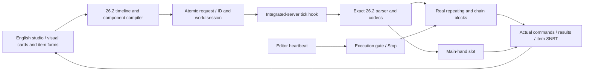

# Live authoring architecture

The central loop is program-side design → authoritative game mutation → observed game state → program-side reconciliation. The launcher and offline NBT editor support that loop.

## Current implementation

The C# host handles native embedding and English UI. Java 25 bridge sources link to the locally installed, unobfuscated 26.2 game jar. Fabric Loader/Mixin supplies the integrated-server hooks without Fabric API. The bridge has no network listener and supports a private integrated server with one player. Dedicated/remote servers are not supported yet.

`LiveConnection` polls atomically replaced `.universal-editor/state.json` in the managed game directory. Requests have a random per-world session and request ID; old requests do not replay in a new session. Acknowledgements identify the processed request and return acceptance/error and actual state. One outstanding mutation is allowed, with Stop able to supersede it. The host renews a session-bound heartbeat. State older than four seconds is offline.

`Bridge` applies requests on the integrated server thread, including during a paused world. It validates identity, private singleplayer scope, command syntax, bounds, loaded chunks and occupancy before changing a chain. Allocation requires air and remains fixed for that world session. Block-entity identities guard against overwriting replacements made in game. Changing chain size only clears tracked objects; there is no forced loading.

The head is an actual repeating block, followed by +Z-facing chains. Minecraft implements execution order, conditions and timing. Replacement deactivates the chain, prepares commands, then enables chains before the head. The execution gate keeps staged editor blocks inert even if redstone powers them. Persisted `UniversalEditor:` custom names mark editor blocks; old marked blocks without an armed binding are also gated on reload. Renaming/removing the marker or removing the mod is outside this guarantee.

Prevalidation and one-server-callback mutation prevent partially validated execution. This is not a general rollback transaction: placement failure may leave a partial but stopped owned chain, and prior command effects are not reversed. Stop disables and clears commands. Normal shutdown clears surviving owned commands, and heartbeat expiry does the same after four seconds. These protections require the bridge to remain installed.

Game-side changes are observed in snapshots. The UI switches Live sync off on external command/flag differences; pulling reconciles the draft. Live sync is opt-in and debounced by 700 ms, and rejected edits turn it off. Snapshot comparison leaves a narrow race before a request arrives; future updates need server-side expected revisions and compare-and-swap.

Item replacement uses the server's `item replace entity <UUID> weapon.mainhand with …` command at gamemaster permission. Actual held state uses the registry-aware `ItemStack.CODEC` with both NBT and JSON. Forms hydrate supported fields, retain unknown components and reuse unchanged original SNBT tokens to preserve numeric/array types. The game validates component ranges. One-shot setup uses the same game engine, feedback and result callback. Syntax validation alone cannot ensure runtime success; block output/success counts expose subsequent failures.

The game exports exact registry choices in session-specific `catalog.json`. Item, enchantment, attribute, effect, entity, block and sound pickers use these. The particle picker exposes only `SimpleParticleType`; parameterized particle codecs need separate forms.

`Authoring.Compile` lowers ordered action cards into real block commands, a per-project scoreboard clock and interval helpers. On-start uses tick 1; delayed actions use delay×20+1. Interval phase subtracts the start tick before modulo. Optional time windows, score comparisons and tag filters generate executable conditions. Shared variable updates run once rather than once per target player. Explicit Run resets the clock; live edits preserve it. See [visual authoring](NO-CODE-DESIGN.md) for scope and usage.

## Import and project model

`Scenario.Import` reads quoted SNBT command fields with nested escaping and separates placed command payloads from the installer shell. The supplied file yields 54 blocks plus 10 other commands without execution. Nodes retain command, order, conditional flag and explanation. Source placement/setup stays in review text, not a lossless placement graph.

Moving the distant installer into a local chain changes execution origin. Scoreboard initialization, lifecycle, loading and old entity/item syntax need semantic conversion and exact-game checks. A complete scenario compiler must model execution context separately from installation location, and distinguish setup/start/repeat/stop/reset/cleanup. Legacy export serializes target and nodes. Structured designs also preserve timeline identity, action choices, timing, conditions and copied item recipes. Full lifecycle, allocation and source preservation are pending.

## Next gates

- Additional component forms, complex rich text and full offline save/reload verification.
- Free-wiring graphs, richer contexts and version-aware compilation with lifecycle controls.
- Semantic import with source-linked diagnostics and preserved unmapped raw commands.
- Durable allocation/rebind/uninstall, revision-checked updates and recoverable transactions.
- Authenticated bridges for owned dedicated servers and tested older-version adapter families.
- Viewport/input/renderer acceptance tests beyond the observed 26.2 rendering/parentage proof.

Primary reference: [Fabric's 26.2 changes](https://fabricmc.net/2026/06/15/262.html). Runtime signatures and parser behavior are checked against the installed official jar. This local authoritative approach does not require first implementing every Minecraft network protocol, and does not establish universal compatibility.
