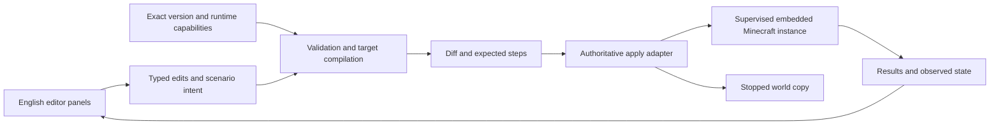

# Research closure and architecture gates

Implementation update: a 26.2 integrated-server bridge and live command/item studio now exist; see [LIVE-STUDIO.md](../LIVE-STUDIO.md). The gates below describe the broader universal target. A local server-thread bridge does not require implementing every network protocol before proving authoring; it does not establish other-version support.

The long-term target is every Java release. Embedded play is mandatory in the first application release; an external game window is not an accepted substitute in this scope.

## Complete the version knowledge base

| Workstream | Already available | Remaining evidence |
| --- | --- | --- |
| Launcher | All 103 release metadata files with checksum verification | Actual runtime/native launch checks, account flow and platform compatibility |
| Version resolution | Exact-name protocol/data mappings | Document explicit aliases; resolve earliest-release gaps; distinguish shared transport from feature equality |
| Protocols | 43 structural packet indices and full source schemas | Read field semantics, state transitions, codecs and permission behavior; cover unindexed target releases |
| Content | Indexed registries for 55 exact release entries | Extract unavailable releases; include tags, pack-dependent content and contextual constraints |
| Commands | Command trees through 29 exact release mappings | Exact-version grammar, parser behavior, permissions, settings and English documentation |
| NBT/components | Major migration boundaries and representative packet definitions | Per-field types, defaults, ranges, persistence, renamed/removed fields, command/disk/network representations |
| World storage | Identified as a distinct subsystem | World/chunk/entity layouts, region compression/external chunks, save locks, corruption handling and upgrade rules |
| Settings | Runtime metadata and current management API boundary | Complete options/server-property/game-rule matrices and restart requirements |
| Explanations | Desired metadata structure and sample timer explanation | Verified English documentation and examples per supported operation |

A release remains `not-tested` until evidence establishes the particular capability. Prefer metadata generated by the exact game build, then compare with pinned community data and Mojang's release notes. Preserve disagreements as research issues. Pack versions, loaded registries and server permissions must be discovered independently where possible.

The current audit has no direct schema/data entries for 26.2 or 26.3. Their protocol IDs are known from the source list, but using 26.1 schemas for them would be an unverified inference. Extracting or sourcing exact modern data is an early priority. Include 26.2 in the embedding experiments to cover its experimental Vulkan backend alongside OpenGL.

## Prove the mandatory embedded viewport

Start with a Windows prototype because the current workspace is on Windows; broader OS scope remains undecided. Evaluate a separate supervised game process hosted in a native panel. Choose a UI toolkit only after the embedding experiment establishes its constraints.

Representative test targets should include 1.0, a late legacy client, 1.12.2, 1.13.2, 1.20.4, 1.21.10 and 26.3. First verify each target's actual native window/input dependencies rather than relying solely on an era label. The 26.3 SDL3 transition requires its own case.

Success means the real client renders and is playable inside the panel: stable focus switching, chat text, cursor locking/releasing, camera motion, resizing, DPI scaling, minimize/restore, and clean process exit. Test supported renderers, multiple monitors and GPU behavior. The application's controls must still provide a way to stop a stalled preview instance. Record per-version results rather than assuming one successful target proves universal embedding.

`SetParent` is a candidate Windows mechanism; its documented DPI/style restrictions are known, while Minecraft interaction remains unproved. If it fails, investigate an explicit game bridge or another host/capture strategy and its latency/rendering/input costs. Do not declare the requirement impossible without testing, and do not promise a framework alone solves it. [Microsoft documentation](https://learn.microsoft.com/en-us/windows/win32/api/winuser/nf-winuser-setparent).

## Prove authoritative live editing

Test a bridge on the integrated server for local singleplayer. Inspect objects, apply a typed change on the server's thread and re-read the result after saving/reloading. A client-only visual edit is insufficient evidence of a successful persistent edit. [Fabric networking documentation](https://docs.fabricmc.net/develop/networking) is a modern reference; it is not evidence of support for every historical release.

For owned servers, compare an authenticated server bridge with command transport and available management APIs. The management protocol is JSON-RPC over WebSocket from 1.21.9; inspect `rpc.discover` for supported methods. It offers administration, not an evidenced arbitrary-NBT API. Legacy command/RCON support also needs an exact-version investigation. [Official management description](https://www.minecraft.net/en-us/article/minecraft-java-edition-1-21-9).

Record the capability boundary: raw inspection, item edits, entity fields, command blocks, player data, server settings and world storage may require different paths. Reject an unsupported operation with a concrete explanation rather than bypassing server authority.

## Preserve intent through version-specific output

The earliest representative scenario should be a small timed effect with a created entity, equipment and a command-block branch. Compile it for both a legacy and modern target; validate output with the exact game. Include a missing-feature case and a failed-command case. English step descriptions must reflect actual tick timing and execution context.

Test offline NBT round trips with type preservation and unknown fields before world editing. Test component range failures and persistence separately. World upgrades should operate on copies; lossless backwards conversion must not be promised for features absent from an older version.

## Architecture decisions after the gates

Choose the desktop host, native embedding interface, launcher/authentication strategy, NBT/storage libraries, content extraction pipeline, scenario representation and bridge families from measured results. A candidate logical flow is:

This diagram describes responsibilities to investigate. It does not settle the technology stack, imply a universal bridge, or claim an implemented application.
